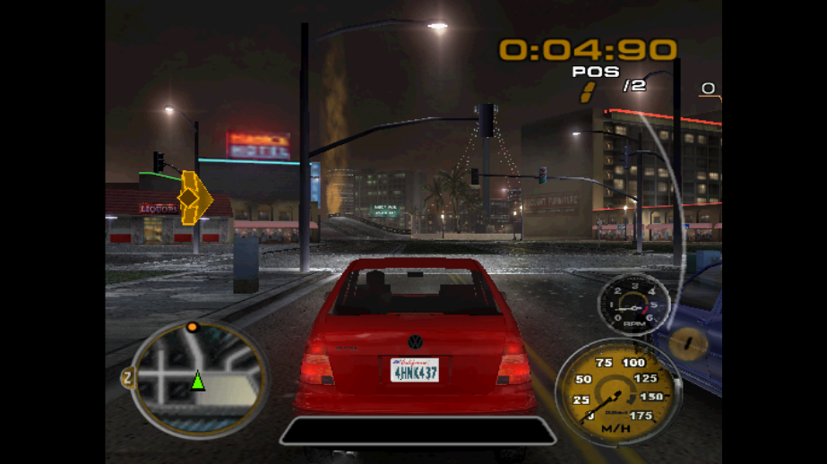

# Midnight Club 3: DUB Edition Remix — Web Port

An experimental browser port of the **PlayStation 2 NTSC-U** release of *Midnight Club 3: DUB Edition Remix*. The game runs locally through static recompilation of its PS2 executable to C++ and WebAssembly, with a PS2 runtime and WebGPU renderer. This project builds on [ps2-web-recomp](https://github.com/snuri00/ps2-web-recomp); [nfsu2-web](https://github.com/th0mk/nfsu2-web) is an architectural reference.

**Status:** A local build boots, reaches the original menus, and drives in San Diego Cruise. Two browser instances have started and driven in the same original LAN Ordered Race. The public site now serves a playable browser build. This is still a research prototype: public cross-machine races, long sessions, sound and save persistence need further validation, and performance on integrated GPUs is below the playable target.

**Play online:** [mc3-web.brdanpe.tech](https://mc3-web.brdanpe.tech/) provides one **Play** entry point, keyboard controls, and short instructions. The browser shell has one **Jogar** button and a graphics-level selector; players choose the game mode in the original menus. For LAN, connect a room before starting the game, then use the original NETWORKING menu. The site serves the disc image and generated WebAssembly, while the relay forwards room traffic over WSS. No separate public room-test page is deployed. The user supplied authorization to distribute the hosted game artifacts; those artifacts are not committed to this repository.



## What works today

- **Game boot and driving:** the PS2 opening, title screen, memory card prompt, original menus, Arcade selection, and San Diego Cruise render in the browser.
- **Local execution:** the PS2 Emotion Engine executable is translated ahead of time; the browser runs the generated WebAssembly, emulates the remaining hardware, renders through WebGPU, and streams disc sectors on demand through HTTP Range requests.
- **Controls and saves:** keyboard, gamepad, and touch input; aspect ratio, resolution and fullscreen controls; a browser-backed virtual PS2 memory card with import and export controls. Long-session save and restore still need end-to-end validation.
- **Multiplayer prototype:** the web shell offers a preparatory LAN room connection, a player name without an account, room creation and invitations. A WebSocket relay forwards binary packets, while an opt-in virtual LAN bridge connects them to the emulated PS2 network adapter. Two instances discovered each other through the game's original **NETWORKING → Host Game / Join Game** flow, entered the original lobby, and started **Ordered Race — Rites of Passage**. Both displayed positions **1/2** and **2/2**, moved independently, and rendered the remote car. Finishing the race and final results have not been verified.
- **Performance diagnostics:** reproducible save states, frame-window benchmarks, GPU/CPU counters, disc-read counters, visual captures, and opt-in renderer experiments. Selective disc preloading eliminated network reads in one Cruise test window but did not materially improve FPS; the graphics path remains the main optimization target.
- **Graphics levels on the start screen:** experimental performance mode keeps 640×512 and uses nearest texture sampling; standard mode retains original filtering at 640×512, with 2× and 3× quality options. The performance mode is opt-in until on-screen FPS is compared on low-end GPUs.
- **Public browser delivery:** versioned static release behind Nginx/TLS, HTTP Range access to the disc, precompressed WebAssembly and data, and the WebSocket relay. The public Solo build rendered the opening sequence. Two Edge tabs joined one room through a generated invitation and both started the game; a complete public two-player race has not yet been verified.
- **Player performance telemetry:** anonymous technical samples are enabled by default with an in-game off switch. The VPS stores FPS, frame timing, emulator and disc counters, and short samples around performance drops in a private SQLite database; the [VPS runbook](docs/VPS_DEPLOYMENT.md) explains how to query it.

The [porting plan](docs/PORTING_PLAN.md), [multiplayer log](docs/MULTIPLAYER_PLAN.md), [performance report](docs/PERFORMANCE.md), [performance checkpoint](docs/PERFORMANCE_CHECKPOINT.md), [low-end GPU plan](docs/LOW_END_GPU_PLAN.md), and [UI asset map](docs/UI_ASSETS.md) contain the test conditions and remaining work.

## Performance checkpoint

| Scene and environment | Observed display rate | Scope |
| --- | ---: | --- |
| San Diego Cruise, Edge on NVIDIA Ampere | **57.22 FPS** | 120-frame benchmark, 640 × 512, with `PS2_CHUNK_WRITES=1`; p95 frame interval was 49.9 ms. |
| Same Cruise state, Intel Gen12-LP | **about 3.1–3.4 FPS** | Browser measurements on this machine; below the 30 FPS playable floor. |
| Two-player Ordered Race, two Edge windows | **about 22–23 FPS** | Short diagnostic captures with both clients and race capture active; not a controlled release benchmark. |

The target is approximately **60 displayed FPS**, with **30 FPS** as the minimum playable rate. Each player's browser renders its own frames; a VPS can serve files and relay network packets, but its GPU cannot increase the client's FPS. These measurements do not establish campaign or broad hardware performance.

## Build and run locally

For a local build, use your own PS2 Remix disc image. The tested image has volume label `MC3REMIX`, boot executable `SLUS_213.55`, and size **8,539,963,392 bytes**. The ISO, translated game code, generated WebAssembly, saves, and build outputs are intentionally excluded from this repository. The public site's separately hosted artifacts are described in the [VPS deployment runbook](docs/VPS_DEPLOYMENT.md).

Prerequisites: Linux or WSL, Git, CMake, Ninja, a C++20 compiler, Python 3, sufficient disk space, and a current Chrome or Edge with WebGPU and the required WebAssembly features. The first web build installs or uses the Emscripten SDK. See the [engine instructions](engine/README.md) for the full toolchain requirements.

```bash
git clone https://github.com/BrunoDanielPF/mc3remix-web.git
cd mc3remix-web
mkdir -p "$HOME/mc3remix-build"
cp -a engine/. "$HOME/mc3remix-build/"
cd "$HOME/mc3remix-build"
scripts/port.sh mc3remix "/absolute/path/to/your/MC3-Remix.iso" --frames 4200 --rounds 4
python3 scripts/serve.py build/web-mc3remix games/mc3remix/disc.iso
```

Open `http://127.0.0.1:8620/` and click **Jogar**. The test server binds to loopback because its `/disc.iso` route exposes the selected disc to anyone who can reach it. To rebuild after editing `engine/`, copy the source into the separate build directory again and run `scripts/build_web.sh mc3remix` there.

### Controls

| Action | Keyboard | PS2 input |
| --- | --- | --- |
| Accelerate | `W` | Left stick up |
| Confirm in menus | `Z` | Cross |
| Brake / reverse | `S` | Square |
| Steer | `A` / `D` | Left stick |
| Handbrake | `Space` or `Q` | R1 |
| Nitro | `E` or `2` | R2 |
| Change camera | `C` | Triangle |
| Headlights / accept race | `X` | Circle |
| Menu navigation | Arrow keys | D-pad |
| Pause / start | `Enter` | Start |
| Fullscreen | `F` | Browser control |

`Shift` maps to L1, `R` or `1` to L2, `V` to L3, and `N` or `Backspace` to Select. `I`/`J`/`K`/`L` also move the left stick. During the opening, press `Z` to advance; at the memory card prompt you can choose **Continue Without Saving**. The web shell also supports a standard gamepad and on-screen touch controls.

## Multiplayer development

The relay is separate from the game server and can be tested locally:

```bash
python3 -m pip install -r engine/scripts/requirements-relay.txt
python3 engine/scripts/room_relay.py
python3 -m unittest discover -s engine/tests -p test_room_relay.py -v
```

With the local game server running, open `http://127.0.0.1:8620/room-test.html` to test room transport. That page verifies packet relay, not a completed in-game race. The original LAN flow currently requires a diagnostic build and opt-in network probes; follow the exact conditions in the [multiplayer log](docs/MULTIPLAYER_PLAN.md). Multiplayer career events, the wider Arcade race catalogue, race completion, player identity inside the original menus, and cross-machine latency are still open work.

For the public build, click **Play**. To use the LAN, click **Conectar sala para LAN**, enter a player name, and create or join a room before pressing **Jogar**. Then use the original **NETWORKING → LAN Play** menu. A room connection validates the relay path; the public original LAN lobby and a complete race across separate machines remain release tests. The game shell uses the current HTTPS host as its WSS relay by default.

The room button only prepares the browser relay and virtual network adapter before the PS2 boot. It does not select a race or game mode; those choices remain in the original game menus.

## Hosting boundary

The hosted build expects `/disc.iso` and contains WebAssembly translated from the game executable. The user supplied authorization to distribute these artifacts on the public VPS. They are transferred outside Git: the disc lives at a separate VPS data path, and generated browser files go into an allowlisted release archive. This repository does not grant rights to redistribute the game or its assets elsewhere. Each player's browser renders the game; the VPS serves files and relays packets. See the [VPS runbook](docs/VPS_DEPLOYMENT.md) for packaging, verification, and rollback.

## Repository layout

- `engine/` — PS2 recompilation pipeline, runtime, browser shell, relay, and tests.
- `site/` — public Play landing page and developer-only room transport test source.
- `deploy/` — allowlisted playable release packaging, Nginx templates, and the older preview packager.
- `docs/` — porting decisions, test evidence, performance measurements, and multiplayer work.
- `main` — published integration branch; `develop` — ongoing development branch.

The engine carries an [MIT license](engine/LICENSE) and its own third-party notices. The root project has no separate license yet. *Midnight Club*, *PlayStation*, and related names and assets belong to their respective owners. This is an independent research project and is not affiliated with or endorsed by Rockstar Games, Sony, or the original developers.
